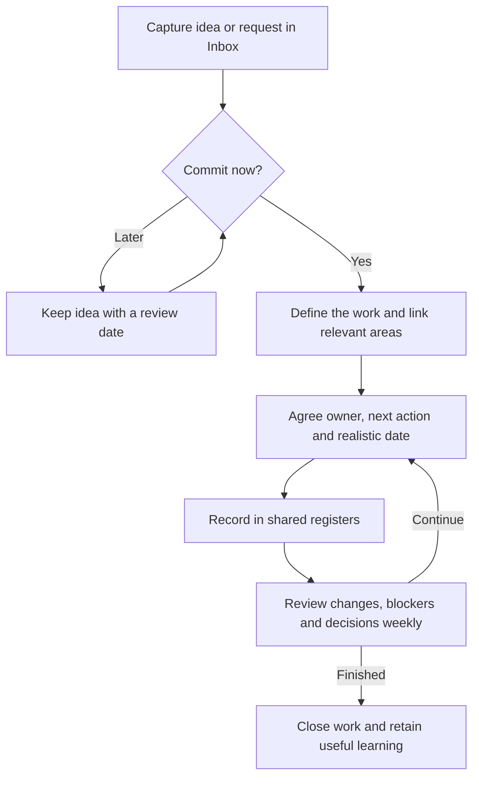

# Projects And Meetings Guide

Keep current work in one place. Use weekly meetings to agree decisions, unblock work and make realistic commitments together.

## Types Of Work

| Type | Meaning | Example |
| --- | --- | --- |
| Area | An ongoing organisational responsibility. | Communications, SE Education, Finance. |
| Project | A defined outcome with a finish. | Q4 Newsletter 2026, Member Survey. |
| Recurring Activity | Recurring delivery. Use this term instead of “workstream”. | Qahwa Gatherings, Expert Talks. |
| Action | A specific next step, named with a verb. “Task” means the same thing. | Send the survey draft to reviewers. |

A project can involve **one area, several areas or the whole chapter**. Link relevant areas and agree one coordinating owner. Actions can also support areas or recurring activities directly.

Example: **Communications → Q4 Newsletter 2026 → Send the draft for review.**

## Where Information Belongs

| Home | Keep Here |
| --- | --- |
| `00_Meta` | Vault guidance, including this process. |
| `01_Governance` | Formal policies, roles and governing decisions. |
| `02_Inbox` | Incoming requests and ideas awaiting a decision. |
| Existing area folders | Area home notes, recurring activities, reusable resources and procedures. |
| `04_Projects` | All project notes, [[Work Overview]] and [[Action Register]]. |
| `03_Meetings` | Dated attendance, discussion, decisions and commitments. |
| `99_Templates` | Short templates for recurring note types. |

**Area home note:** purpose, people, recurring activities, project links and reusable resources.

**Project note:** purpose, what “done” means, relevant areas, milestones and supporting links.

Keep recurring activities in their area. Create a project for an individual edition only when its planning warrants one.

## Record Current Work Once

| Shared Record | One Row Represents | Main Fields |
| --- | --- | --- |
| Work Overview | A project or recurring activity. | Name, type, relevant areas, owner, status, next milestone and target date. |
| Action Register | One specific next step. | Action, related work, owner, due date, status and brief notes. |

Use Smart Tables with owner/status dropdowns and calendar dates. Use Title Case for headings, table headers and dropdown labels. YAML property names stay lowercase. Unknown owner: **TBD**; unknown date: **blank**. For recurring activities, track the next occurrence or review date.

Use the same statuses for work and actions: **TBD, Backlog, Pending, In Progress, Blocked, In Review, Completed, Deferred, Cancelled**. Backlog = uncommitted; Pending = accepted; Blocked = needs help/dependency; Deferred = postponed; Cancelled = no longer needed. Status applies to the row: completing an action does not complete its project or recurring activity.

## Weekly Meeting Process

| When | What Members Do |
| --- | --- |
| Before | Run **Prepare Today’s Weekly Meeting** from the command palette, or use the meeting template and select **Connect For Editing**. Owners can update the meeting tables or the shared registers. Add agenda questions and intended outcomes. |
| During | Take attendance → review previous actions and progress together → discuss agenda and record decisions → enter new commitments in Section 4 → review parking lot and next meeting. |
| After | Select **Finish Meeting & Keep Snapshot** in Section 4. The registers keep current work; the meeting retains dated minutes. |

Section 2 is one combined table. **Type** distinguishes Project, Recurring Activity and Action; owners, dates and statuses apply to that row. **Related Work / Areas** connects an action to its parent work, or identifies the areas involved in a project. Section 3 records decisions; Section 4 accepts new actions; Section 5 holds deferred discussions. Postponed actions remain Deferred.

While connected, edit Section 2, Section 4, [[Work Overview]] or [[Action Register]] directly. MENACOSE Table Links keeps their values in sync, including in Live Preview. New commitments reach the register once their Action has text; blank starter rows stay blank. No manual IDs or YAML fields are needed.

Finish a meeting to freeze its tables. Preparing another connected meeting also freezes the previous one. Copying an old note does not connect the copy automatically; use **Connect For Editing** if needed. Removing a meeting row only removes it from that meeting. Use Cancelled to close an action across the shared records.

## Working As Volunteers

- Agree a willing owner and a small number of achievable next steps.
- Set realistic dates; use review dates when timing is uncertain.
- Ask for help early. Rescope, defer or cancel as capacity changes.

## Chapter Statistics

Use [[Chapter Dashboard]] for live core-team participation, activity attendance and current work. Board meeting checklists supply participation; [[Activity Register]] holds one row per edition with status and aggregate attendance. Leave unknown counts blank and confirm Held only after delivery. The dashboard flags missing records and counts meeting copies once.

**Start here:** [[Work Overview]] · [[Action Register]] · [[Area Directory]] · [[MENACOSE People]]. Use [[Project Template]], [[Recurring Activity Template]] and [[Meeting Agenda and MoMs]] for new notes.

Historical weekly tables remain dated snapshots. Project links and backlinks are maintained by MENACOSE Table Links; renaming a linked note also updates its table link. Use the pencil to edit a link.
